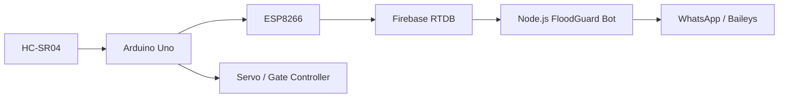

<div align="center">

# 🌊 FloodGuard WhatsApp Bot

### Real-time flood monitoring, cloud alerts and emergency-status messaging


[](https://github.com/teldigi5-wq/floodguard-whatsapp-bot/actions/workflows/ci.yml)

**The cloud-notification layer of the FloodGuard IoT flood-monitoring ecosystem.**

</div>

---

## 🎯 Project snapshot

FloodGuard connects real water-level sensing hardware to Firebase and a cloud-hosted WhatsApp service so users can query system state and receive meaningful alerts when flood conditions change.

This repository focuses on the **monitoring and notification layer**. Physical gate control remains on the embedded controller side.

| Layer | Technology |
|---|---|
| Sensing | HC-SR04 ultrasonic sensor |
| Controller | Arduino Uno |
| Connectivity | ESP8266 |
| Realtime backend | Firebase RTDB |
| Messaging service | Node.js + Baileys |
| Hosting | Provider-independent Node.js + persistent disk (AWS deployment unavailable) |
| User channel | WhatsApp |

---

## AWS-independent recovery status

**14 October 2026 — owner-reported hosting outage:** The original AWS account is banned/unavailable. The FloodGuard WhatsApp bot **worked when previously deployed on EC2**, but its current downtime is a hosting/account issue, not evidence of a code or Arduino/ESP8266 failure. No AWS instance or session backup is presumed accessible. The flashed Arduino and ESP8266 remain untouched.

**New preferred model:** a self-hosted Node.js process on a machine with persistent storage (for example a no-charge VM if available, or a local PC when online). The application source does not require AWS. Setup routes now default to loopback binding; for remote access use a TLS-protected proxy or authenticated tunnel. See [recovery without AWS](docs/RECOVERY_WITHOUT_AWS.md).

**Do not deploy from this draft PR until reviewed.** Neither a new host nor its administrative secrets have been provisioned, the original WhatsApp session might be unrecoverable, and Phase A Firebase rules remain un-published.

## ✅ Validation and deployment

FloodGuard now separates **code validation** from **production deployment**.

The CI workflow runs on pushes and pull requests and verifies the project with Node.js 20, a clean `npm ci` install, the repository's syntax/source checks, and required-file validation before changes are treated as healthy.

Production deployment remains handled by the dedicated EC2 workflow, which updates the running service and preserves the deployment model independently from pull-request validation.

This gives the repository two clear signals:

- **CI** — proves the source tree is syntactically valid and structurally complete on a clean runner.
- **Deployment** — updates the AWS EC2 service after accepted changes reach `main`.

---

## 🏗️ End-to-end architecture



```text
Water level
   ↓
HC-SR04 sensor
   ↓
Arduino Uno
   ↓
ESP8266
   ↓
Firebase RTDB
   ↓
AWS EC2 Node.js bot
   ↓
WhatsApp commands + alerts
```

---

## ⚡ Core capabilities

- Real-time Firebase RTDB monitoring
- `SAFE`, `WARNING`, `DANGER` and `SENSOR_ERROR` states
- Transition-based warning and danger alerts
- Recovery notifications
- Gate countdown milestones and gate-state reporting
- Stale-data protection
- Sensor-error reporting
- ESP8266/network-status reporting
- Subscriber management
- QR-based WhatsApp device linking
- Persistent authentication storage on EC2
- PM2 process management
- No fabricated sensor or rainfall readings

---

## 💬 WhatsApp command surface

| Command | Purpose |
|---|---|
| `menu` | Show available commands |
| `stats` | Current FloodGuard status |
| `water` | Water-level information |
| `risk` | Current flood-risk state |
| `gate` | Gate state / countdown |
| `devices` | Device information |
| `rain` | Rain-gauge status |
| `network` | ESP8266 / network status |
| `emergency` | Emergency information |
| `subscribe` | Subscribe to alerts |
| `unsubscribe` | Stop alert subscription |

---

## 🛡️ Reliability design

### Stale data

`FLOODGUARD_STALE_MS` prevents an old Firebase record from being presented as a fresh sensor reading.

### Sensor errors

Invalid or unavailable readings become `SENSOR_ERROR` instead of being converted into a fake safe/warning/danger value.

### Transition alerts

The bot responds to meaningful state transitions instead of spamming the same warning every time Firebase updates.

### Authentication persistence

The WhatsApp linked-device session is stored outside the source tree so application updates do not force a new QR scan every time.

---

## 🔄 Data flow

Firebase exposes live FloodGuard state under the project data path. The bot converts that state into user-facing status and alerts.

Important values include:

```text
water.levelCm      calculated water level
water.distanceCm   raw ultrasonic air-gap distance
gate               current gate state
alarm              alarm state
esp8266            network/device state
system             overall system state
```

The bot treats Firebase as the live communication boundary between the embedded hardware and the cloud messaging service.

---

## ☁️ AWS EC2 deployment

The production service is intended to run under **PM2** on AWS EC2.

### Example environment

```env
PORT=8080
DATA_PATH=/data
FIREBASE_DATABASE_URL=YOUR_FIREBASE_RTDB_URL
FIREBASE_AUTH=
FLOODGUARD_STALE_MS=15000
```

> Never commit production secrets, credentials, `.env` files or WhatsApp authentication data.

### Install / update

```bash
cd ~/floodguard-whatsapp-bot
git pull origin main
npm ci --omit=dev || npm install --omit=dev
npm run check
pm2 restart floodguard-whatsapp-bot --update-env
pm2 save
```

### Health checks

```bash
pm2 status
pm2 logs floodguard-whatsapp-bot --lines 50
```

Healthy operation should show successful WhatsApp and Firebase connectivity.

---

## 🔐 Preserve linked-device authentication

Production uses:

```text
DATA_PATH=/data
/data/auth
```

**Do not delete `/data` or `/data/auth` during deployment.**

Keeping authentication outside the repository allows source updates without destroying the linked WhatsApp session.

---

## 📱 QR setup page

The setup page can:

- poll connection state automatically
- display newly generated QR codes
- hide expired displayed codes
- show a waiting state while WhatsApp generates the next QR
- switch to a connected state after linking
- expose WhatsApp and Firebase connection status

`QR_DISPLAY_TTL_MS` controls display lifetime only; new QR values still originate from the real Baileys/WhatsApp connection process.

---

## 🌐 FloodGuard ecosystem

This repository is one part of a larger system that includes:

- embedded water-level sensing
- Arduino control logic
- ESP8266 connectivity
- Firebase real-time synchronization
- automated gate behavior
- buzzer / LED / LCD alerts
- mobile and web monitoring interfaces
- AWS-hosted WhatsApp notifications

That full path makes FloodGuard useful as a portfolio example of **IoT → cloud → user communication** rather than just an isolated bot.

---

## 💼 What this project demonstrates

- embedded-to-cloud system integration
- realtime database consumption
- event/state transition design
- reliability around stale and invalid sensor data
- Node.js service deployment
- process management with PM2
- persistent authentication handling
- messaging UX for an IoT system
- separation of CI validation from production deployment

---

## 🗺️ Next upgrades

- [ ] Add automated tests around state transitions and stale-data behavior
- [ ] Add structured health/readiness endpoints for deployment monitoring
- [ ] Add screenshots of the QR setup page and WhatsApp command responses
- [ ] Add a complete FloodGuard architecture diagram spanning hardware, Firebase, web, mobile and messaging
- [ ] Add versioned releases and deployment notes

---

<div align="center">

### Sense → Detect → Alert → Respond

**Built by Poojana Kaveesh as part of the FloodGuard project.**

</div>


### Cross-repository emulator acceptance (not a live rollout)

The new `Firebase bot contract — safe child streams` GitHub Action uses the candidate rules from a **pinned public website commit**, starts a local RTDB Emulator, and verifies `getLive()` and `streamLive()` using synthetic readings with test-only ESP8266 private values. It must pass before a real EC2 deployment is considered. It never contacts production Firebase or sends WhatsApp messages.

### Supervised EC2 rollout only

The review PR also changes the GitHub Actions EC2 deployment trigger from automatic `main` pushes to **manual `workflow_dispatch` only**. Once merged and tested, an operator must select the specific reviewed 40-character commit SHA, choose `DEPLOY`, and run the workflow. It refuses to deploy if the remote `main` SHA differs, or if necessary EC2 secrets are missing. The job targets the `floodguard-ec2-production` GitHub environment; configure required reviewers/environment protections separately if desired.

**While this change is still in the draft PR, the production `main` branch retains its existing automatic deploy trigger. Do not merge other changes to bot `main` before this is approved.**

### Hardware offline, telemetry last recorded

The Arduino and ESP8266 are **already flashed and were working correctly**, according to the owner; the hardware is currently offline and unavailable for remote testing. **Do not reflash or restart the gate to validate this bot.** Firebase can remain connected even when its last sensor update is old. The bot must show historical measurements as **last recorded**, never infer live hardware from a Firebase connection, and must not issue automatic flood/gate alerts from expired or invalid timestamps. Offline UI changes can be tested with synthetic source values while EC2 deployment remains owner-approved and manual-only on this draft PR.

### PC and EC2 hosting settings

Runtime profiles: FLOODGUARD_HOST_MODE=pc or ec2. Start from an approved machine with npm run start:pc or npm run start:ec2. Both use the same bot and persistent local DATA_PATH. A Hosting Settings panel on the protected setup page shows the current profile and lets you preview the PC/EC2 configuration steps; it does not move or remotely deploy the running process.

For Windows setup, use scripts/setup-windows.ps1 on your own PC. The script generates a private .env with a random admin token and a data directory without overwriting existing configuration. See docs/DUAL_HOST_SETTINGS.md for full instructions. Never run both PC and EC2 bots with the same WhatsApp linked session simultaneously.
### Private WhatsApp setup access (draft migration requirement)

The link/setup page `/`, `/status`, and `/qr` contain sensitive device-linking or diagnostic information. The draft update requires a private, random `FLOODGUARD_SETUP_TOKEN` (minimum 32 printable ASCII characters). Browsers authenticate with an HTTP **Basic Auth** prompt: username `admin`, password the secret token. The existing page, status polling and QR-image requests continue to use browser same-origin credentials. Tokens in query strings or URLs do not work. No WhatsApp QR values or phone identifiers are printed in public health responses.

**Deployment prerequisite:** provision the secret in the **EC2 process environment** (not GitHub, not the repository, not browser JavaScript) and confirm the local admin UI through an **HTTPS-only** reverse proxy or an authenticated private tunnel. Basic Auth MUST NOT be used over plaintext public HTTP; do not expose port 8080 directly to the Internet. Enforce EC2 ingress allowlists, TLS and request rate limiting upstream. The public `/health` endpoint is limited to generic service liveness. If the token is not configured or too weak, setup routes return HTTP 503 rather than exposing WhatsApp QR data. Preserve `DATA_PATH/auth`; a rollout must not destroy the linked WhatsApp session.

**Current production remains unchanged.** This behavior exists only in draft PR #12 until owner-approved supervised deployment. Confirm actual EC2 firewall, proxy, health checks, and environment configuration before merging or running the exact-SHA manual deploy.
