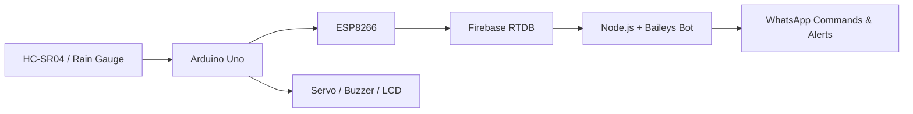

<div align="center">

# 🌊 FloodGuard WhatsApp Bot

### IoT flood monitoring · Firebase telemetry · WhatsApp alerts


[](https://github.com/teldigi5-wq/floodguard-whatsapp-bot/actions/workflows/ci.yml)

**Cloud-connected monitoring and messaging for the FloodGuard Arduino/ESP8266 flood-warning prototype.**

</div>

---

## Project status

| Component | Status |
| --- | --- |
| Arduino Uno and ESP8266 | Already flashed and previously working, per owner; currently offline for remote testing |
| WhatsApp bot | Worked on the former AWS deployment; currently not hosted |
| Windows PC hosting | Prepared in [draft PR #12](https://github.com/teldigi5-wq/floodguard-whatsapp-bot/pull/12), Windows CI tested; **not installed on the owner's PC** |
| Optional EC2 hosting | Supported by the same Node.js application; requires a new, accessible, approved VM |
| Firebase privacy | Proposed rules are review-only; live anonymous read/write exposure has **not** been remediated |

This repository is the **messaging layer**. Physical flood sensing, alarms, and gate control remain with the embedded hardware. This educational prototype is **not a certified public flood-warning service**. Firebase may continue serving old readings while the hardware is offline; the bot identifies stale values and suppresses automatic alerts based on expired data.

## Architecture



The bot consumes **allowlisted Firebase child telemetry paths**. It provides the `menu`, `stats`, `water`, `risk`, `gate`, `rain`, `devices`, `network`, `emergency`, `subscribe` and `unsubscribe` commands. Its WhatsApp device-linking session and subscriber state live in a private, persistent `DATA_PATH` directory.

## Deployment guide

**Choose one host at a time.** You can run the same application either on your **Windows PC** or on an approved **EC2 Linux VM**. The Hosting Settings selector is a *read-only planning aid*; it cannot move the bot between machines.

The PC setup is the recommended recovery path while the old AWS account/host is unavailable. Neither option requires reflashing the working Arduino or ESP8266.

### Offline preview — no WhatsApp pairing required

If you **do not want to link WhatsApp yet**, you can inspect the premium FloodGuard administration UI and select simulated SAFE/WARNING/DANGER/Offline states using an isolated local server. This preview does not import or initialize WhatsApp/Baileys, connect to Firebase, use real telemetry, or perform hardware/gate actions. It contains **no QR pairing** and sends **no alerts**. The demo also includes a **read-only WhatsApp command preview** for `menu`, `stats`, `water`, `risk`, `gate`, `rain`, `devices`, `network` and `emergency`. All responses use synthetic examples. `subscribe` and `unsubscribe` are deliberately unavailable, and no user messages are sent.

After checking out the reviewed draft branch on your Windows PC:

```powershell
npm ci
npm test
powershell -NoProfile -ExecutionPolicy Bypass -File .\scripts\setup-windows.ps1
npm run doctor
npm run start:demo
```

Open `http://127.0.0.1:8085` **on that same PC** and enter your local admin username `admin` and the private `FLOODGUARD_SETUP_TOKEN` value from `.env`. The page visibly displays **SIMULATION ONLY · NO LIVE DATA** and lets you switch synthetic scenarios. Stop the preview with `Ctrl+C`.

**Do not run `npm run start:pc` or `npm run start:ec2` until you actually want to link WhatsApp.** Those are real bot processes. No change is required to the already-flashed Arduino/ESP8266.

### 1. Windows PC — first installation

**Prerequisites:** Windows 10/11, [Node.js 20+](https://nodejs.org/), [Git](https://git-scm.com/), internet access, and a phone authorized to link the WhatsApp account. Your PC must remain powered on and connected while you want the bot to respond.

In **PowerShell**:

```powershell
git clone https://github.com/teldigi5-wq/floodguard-whatsapp-bot.git
cd floodguard-whatsapp-bot

# The PC deployment support is still in draft PR #12, not main.
git fetch origin
git switch --track origin/security/allowlisted-firebase-telemetry-v1

# Validate the exact reviewed source before starting it.
npm ci
npm run check
npm test

# Creates .env, a strong random admin password and data/ if absent.
# Existing .env is NOT overwritten.
powershell -NoProfile -ExecutionPolicy Bypass -File .\scripts\setup-windows.ps1

# Offline readiness check: never connects to WhatsApp or Firebase.
npm run doctor

# Starts the one local WhatsApp bot instance.
npm run start:pc
```

The setup helper sets `FLOODGUARD_HOST_MODE=pc`, binds the admin page to `127.0.0.1`, and uses `./data` for persistent files. The token and session files remain on your computer, never in GitHub.

**Open** `http://127.0.0.1:8080` on the **same PC**. At the browser sign-in prompt, use username `admin` and the value of `FLOODGUARD_SETUP_TOKEN` from your local private `.env` as the password. The page displays the real WhatsApp QR only when a new device link is required.

If a legitimate **private backup** of the old WhatsApp `auth/` directory exists, preserve and restore it only while the bot is stopped. If no backup is available from the unavailable AWS host, use the authorized phone to scan a **new QR code**. GitHub source code does not contain the old WhatsApp login.

**Stop:** press `Ctrl+C` in the running terminal. **Start again:** run `npm run start:pc` in the project directory. Do not run a second bot instance against the same `data/auth` directory.

**Preflight check:** `npm run doctor` performs an offline, read-only review of Node.js version, the PC/EC2 profile, loopback-only admin binding, token format, RTDB HTTPS-origin syntax, a usable data directory and stale-data threshold. It does **not** connect to Firebase, WhatsApp or the Arduino. `PASS` means only the local configuration is structurally ready—not that pairing, firewall/TLS setup, online telemetry or persistent cloud storage has been verified. Missing previous WhatsApp session data is a warning, not a code failure. The check never prints token values or private paths.

### 2. Required private settings

`scripts/setup-windows.ps1` creates a starter `.env` on Windows. For another host, copy `.env.example` to a private `.env` and configure it yourself. Never commit the file or share its token.

| Setting | Windows PC | Optional EC2 |
| --- | --- | --- |
| `FLOODGUARD_HOST_MODE` | `pc` | `ec2` |
| `HOST` | `127.0.0.1` | `127.0.0.1`, via private tunnel / HTTPS proxy |
| `PORT` | `8080` | `8080` or privately configured |
| `DATA_PATH` | `./data` | Absolute path on an operator-verified persistent writable disk |
| `FIREBASE_DATABASE_URL` | Existing Firebase RTDB HTTPS origin | Same approved RTDB origin |
| `FLOODGUARD_SETUP_TOKEN` | Random token created by Windows helper | Generate a new strong secret privately |
| `FLOODGUARD_STALE_MS` | `15000` by default | `15000` by default |

`FIREBASE_AUTH` is empty only while the current RTDB read permissions allow the required public monitoring children. **This does not mean the live database is secure.** Firebase private-read and authenticated-write migrations are separate review and approval steps.

Never put the setup token into a URL, browser JavaScript, GitHub issue, CI log or repository. The private admin endpoints `/`, `/status`, `/qr` and `/hosting` require it. `/health` intentionally returns **generic liveness only**, not proof of WhatsApp or sensor connectivity.

### 3. AWS EC2 — optional future deployment

This path applies **only to a newly accessible EC2 VM that you own or are authorized to administer**. It does **not** reactivate the previous unavailable AWS account, recover the previous `/data/auth`, or reuse the historical `.github/workflows/deploy.yml` target.

Prepare an approved Linux VM with Node.js 20+, Git, outbound access to WhatsApp/Firebase, and a **persistent writable disk**. Restrict security-group inbound access. Install the reviewed draft code:

```bash
git clone https://github.com/teldigi5-wq/floodguard-whatsapp-bot.git
cd floodguard-whatsapp-bot
git fetch origin
git switch --track origin/security/allowlisted-firebase-telemetry-v1

npm ci
npm run check
npm test
cp .env.example .env
chmod 600 .env
```

**Privately edit `.env`** before starting. Set `FLOODGUARD_HOST_MODE=ec2`, `HOST=127.0.0.1`, your verified persistent `DATA_PATH`, and a fresh random `FLOODGUARD_SETUP_TOKEN` (at least 32 printable characters). The example file deliberately does **not** contain a real token. Ensure the chosen service account can read/write the data directory; do not put private auth on an ephemeral filesystem.

```bash
# Check configuration locally before any network connection:
npm run doctor

# First do a supervised foreground smoke test:
npm run start:ec2

# After that succeeds, stop it before starting ONE managed instance.
npm install --global pm2
pm2 start ecosystem.portable.config.js
pm2 status
pm2 save
```

Keep the admin HTTP listener bound to `127.0.0.1`. To access the QR screen from your own computer, use an **authorized SSH tunnel** (example; replace placeholders with your approved VM user and address):

```bash
ssh -L 8080:127.0.0.1:8080 USER@APPROVED_VM_HOST
```

Then open `http://127.0.0.1:8080` **on your computer** while the tunnel is running. Alternatively configure an audited HTTPS-only reverse proxy, authentication and rate limits. **Never expose the Basic Auth setup page directly over public HTTP or open port 8080 to the internet.**

The optional EC2 profile does **not** deploy itself. A future VM, its billing, private SSH access, backup and any automated deployment must be separately approved. Do not invoke the legacy GitHub EC2 deploy workflow until its destination has been redesigned and verified.

### 4. Verify after starting

1. On the host, open `http://127.0.0.1:8080/health`. `status: ok` means the **HTTP process** is serving requests, not that WhatsApp or the Arduino is online.
2. Sign into the private setup page and verify WhatsApp status, Firebase connectivity, and the **Hosting Settings** panel (`PC` or `EC2` as configured). The settings panel is informational: it does not write credentials or change hosting.
3. If WhatsApp requires linking, complete the QR scan using the authorized phone. Send `menu` and `stats`, then test `water`, `gate` and `network` after pairing.
4. When hardware is offline, confirm the bot labels the previously stored sensor readings **STALE / last recorded**, with no invented live gate countdown or automatic alert based on expired readings.
5. Verify data survives a normal process restart (`data/auth`, `subscribers.json`, `state.json`); do not reveal the contents. A writable directory alone does not guarantee cloud-volume durability.

**If WhatsApp works but Firebase reports stale values**, that is expected while the already-flashed hardware is offline; it does not establish a hardware or firmware failure.

### 5. Updates, rollback and persistent sessions

- Record the exact **tested Git commit SHA** before an update. Stop the bot, privately back up `DATA_PATH` and your secret `.env`, and update code only after CI and operator review.
- Keep the `auth/` directory outside source control, on persistent storage. Do not delete it merely to fix a network failure; a fresh QR link should be the last resort when the WhatsApp session is genuinely invalid.
- Roll back to the previous reviewed SHA with a supervised checkout and the original private environment/session files if a new revision fails. Never run PC and EC2 instances linked to the same account concurrently.
- PC foreground process: stop with `Ctrl+C` and restart with `npm run start:pc`. Reviewed Linux PM2 process: `pm2 restart floodguard-whatsapp-bot --update-env` after a controlled update.
- Backups must remain encrypted/private. Do not upload WhatsApp credentials, Firebase tokens or subscriber phone identifiers to public GitHub or CI artifacts.

### Deployment checklist

- [ ] Node.js 20+, Git, internet and the chosen hosting account/machine available
- [ ] Correct branch/commit checked out; `npm test` and `npm run doctor` passed
- [ ] Private `.env` configured, admin setup token strong, data directory persistent
- [ ] One bot instance only; QR interface loopback-only or protected by SSH tunnel / HTTPS
- [ ] Authorized WhatsApp pairing and `menu` / `stats` smoke test completed
- [ ] Offline sensor readings clearly labeled stale; no false live alert
- [ ] Private auth/session backup and a tested process restart
- [ ] No legacy EC2 workflow run, Firebase rules publication, or hardware reflash without separate approval

Full procedures: [PC & EC2 hosting settings](docs/DUAL_HOST_SETTINGS.md) · [Recovery without AWS](docs/RECOVERY_WITHOUT_AWS.md) · [Review PR #12](https://github.com/teldigi5-wq/floodguard-whatsapp-bot/pull/12).

## Hosting Settings

The protected setup page has a responsive Hosting Settings section showing the running profile, listener scope, and data-directory accessibility **without revealing the filesystem path or credentials**. Its PC/EC2 selector displays instructions **only**. Changing the actual runtime requires configuring and starting the bot on the intended host.

## Monitoring and alerts

| Command | Information |
| --- | --- |
| `menu` / `help` | Available WhatsApp commands |
| `stats` | Water, gate, risk, alarm and last-update summary |
| `water` | Sensor air gap, calculated water level and thresholds |
| `risk` / `emergency` | Reported system risk and alarm status |
| `gate` | Recorded gate state and countdown, clearly marked if stale |
| `rain` | Rain gauge availability and genuine reported rainfall |
| `devices` | Last reported installed-device status |
| `network` | Public ESP8266 connection state and RSSI, without private IP/Wi-Fi values |
| `subscribe` / `unsubscribe` | Opt in or out of automatic WhatsApp transition alerts |

The bot suppresses transition alerts from invalid, future-dated or expired field timestamps. It reads nine allowlisted RTDB children and never requires the application to fetch the private ESP8266 IP or Wi-Fi fields.

## Quality gates and security

GitHub Actions test Node.js syntax, source/regression suites, Windows PC setup, and Firebase child-stream compatibility using **synthetic data in a Firebase Emulator**. See [CI](https://github.com/teldigi5-wq/floodguard-whatsapp-bot/actions/workflows/ci.yml), [Windows setup workflow](https://github.com/teldigi5-wq/floodguard-whatsapp-bot/actions/workflows/windows-pc-smoke.yml), and [Firebase contract workflow](https://github.com/teldigi5-wq/floodguard-whatsapp-bot/actions/workflows/firebase-contract.yml).

**CI is not a live deployment test.** The code in [PR #12](https://github.com/teldigi5-wq/floodguard-whatsapp-bot/pull/12) remains a draft, not merged or running on the owner's PC/EC2. The currently published Firebase RTDB permissions still require a supervised private-read containment update and, later, independently approved authenticated device uploads. Neither the bot nor this README modifies production Firebase rules or the functioning Arduino/ESP8266 firmware.

---

<div align="center">

**FloodGuard** · Sense → Detect → Alert → Respond

Arduino / ESP8266 · Firebase · Node.js · WhatsApp · Flutter · Web

**Built by Poojana Kaveesh**

</div>
